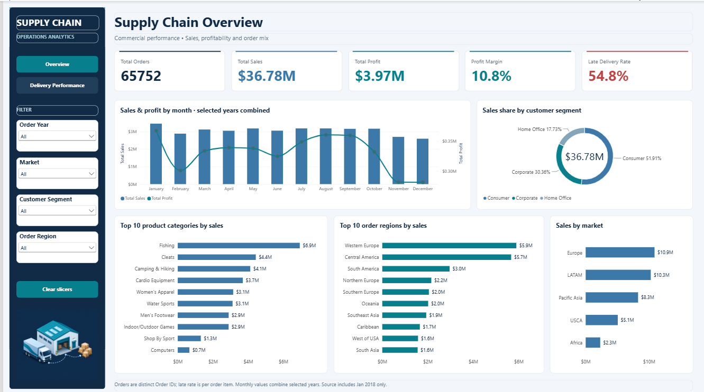
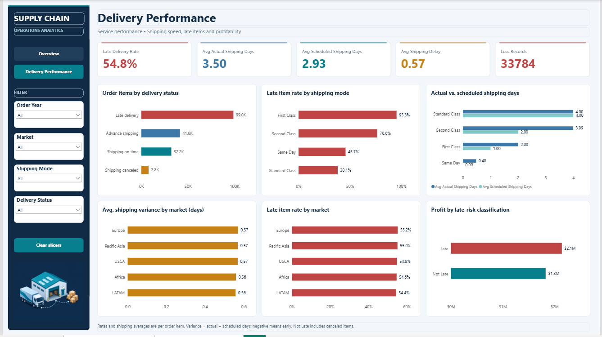

# Supply Chain Sales & Delivery Performance Analysis

## Project Overview

This project analyzes supply chain sales, profitability, shipping performance, and delivery efficiency using SQL Server, Power Query, DAX, and Power BI.

The objective is to compare performance across markets, regions, product categories, and customer segments, evaluate shipping and late-delivery performance, and present the results through an interactive two-page Power BI dashboard.

### Project Workflow

**Raw CSV → SQL Profiling & Business Analysis → Power Query Cleaning → DAX Measures → Power BI Dashboard → Validation → Business Insights**

---

## Tools Used

- SQL Server
- SQL Server Management Studio (SSMS)
- Power BI Desktop
- Power Query
- DAX
- CSV Dataset
- GitHub

---

## Dataset Overview

The project uses the **DataCo Supply Chain practice dataset**, where each row represents an individual order item.

Important fields include:

- Order ID and Order Item ID
- Order Date and Shipping Date
- Market and Order Region
- Customer Segment
- Category Name
- Sales and Order Profit
- Order Quantity
- Actual Shipping Days
- Scheduled Shipping Days
- Shipping Mode
- Delivery Status
- Late Delivery Risk

### Dataset Size

- **180,519 order-item records**
- **65,752 distinct orders**
- **180,519 distinct Order Item IDs**
- Order dates from **1 January 2015 to 31 January 2018**

> The 2018 data contains January only and should not be treated as a complete year when comparing annual performance.

---

## SQL Analysis

The dataset was loaded into SQL Server for profiling, business analysis, and validation.

SQL analysis included:

- Total record count
- Distinct Order ID and Order Item ID validation
- Review of data types and important categorical fields
- Overall sales and profit analysis
- Sales by market and region
- Product category performance
- Customer segment analysis
- Monthly sales and profit trends
- Shipping mode analysis
- Delivery status analysis
- Late-delivery performance
- Loss-making order-item analysis

The Power BI model uses the SQL table:

`dbo.dataco_supply_chain`

and loads it into Power BI as:

`Supply_Chain`

---

## Data Cleaning & Transformation

Power Query was used to prepare the dataset for reporting.

Main transformations included:

- Removed unnecessary customer, address, image, and unused identifier fields
- Renamed source columns to readable business names
- Corrected shipping-day and late-risk data types
- Created **Shipping Delay Days**
- Created **Delivery Performance**
- Created **Profit Status**
- Created **Order Year**
- Created **Order Month**
- Created **Order Month Number**
- Retained all **180,519 order-item records**

### Calculated Fields

**Shipping Delay Days**

`Actual Shipping Days - Scheduled Shipping Days`

A positive value indicates shipping took longer than scheduled, while a negative value indicates earlier delivery.

**Delivery Performance**

- Late Delivery Risk = 1 → `Late`
- Otherwise → `Not Late`

**Profit Status**

- Order Profit < 0 → `Loss`
- Otherwise → `Profit`

---

## DAX Measures

Key DAX measures created for the dashboard include:

- Total Orders
- Total Quantity
- Total Sales
- Total Profit
- Profit Margin
- Late Delivery Records
- Late Delivery Rate
- Late Delivery Count
- Avg Actual Shipping Days
- Avg Scheduled Shipping Days
- Avg Shipping Delay
- Loss Records

### Main KPI Results

| KPI | Result |
|---|---:|
| Total Orders | 65,752 |
| Total Sales | $36.78M |
| Total Profit | $3.97M |
| Profit Margin | 10.78% |
| Late Delivery Rate | 54.83% |
| Late Delivery Records | 98,977 |
| Avg Actual Shipping Days | 3.50 |
| Avg Scheduled Shipping Days | 2.93 |
| Avg Shipping Variance | 0.57 days |
| Loss Records | 33,784 |

> Total Orders uses a distinct count of Order ID. Shipping averages, late-delivery rate, and loss counts are calculated at order-item level.

---

# Power BI Dashboard

The final report contains two interactive dashboard pages with a consistent supply-chain theme.

## Page 1 — Supply Chain Overview



The overview page provides:

- Total Orders
- Total Sales
- Total Profit
- Profit Margin
- Late Delivery Rate
- Monthly Sales & Profit Trend
- Sales Share by Customer Segment
- Top 10 Product Categories by Sales
- Top 10 Order Regions by Sales
- Sales by Market

### Slicers

- Order Year
- Market
- Customer Segment
- Order Region

---

## Page 2 — Delivery Performance



The delivery-performance page provides:

- Late Delivery Rate
- Average Actual Shipping Days
- Average Scheduled Shipping Days
- Average Shipping Delay
- Loss Records
- Order Items by Delivery Status
- Late Item Rate by Shipping Mode
- Actual vs Scheduled Shipping Days
- Average Shipping Variance by Market
- Late Item Rate by Market
- Profit by Late-Risk Classification

### Slicers

- Order Year
- Market
- Shipping Mode
- Delivery Status

---

## Interactive Features

The dashboard includes:

- Page navigation between Overview and Delivery Performance
- Clear Slicers buttons
- Interactive chart filtering
- Hover tooltips
- Synchronized Order Year and Market filters across both pages
- Supply-chain themed sidebar and illustrations

---

## Key Business Insights

- Total Sales were approximately **$36.78M** with **$3.97M** in Total Profit.
- Overall Profit Margin was approximately **10.78%**.
- The dataset contains **65,752 distinct orders** and **180,519 order items**.
- Europe generated the highest sales at approximately **$10.87M**.
- LATAM followed with approximately **$10.28M** in sales.
- Fishing was the highest-selling product category at approximately **$6.93M**.
- Consumer customers contributed approximately **51.91%** of total sales.
- Approximately **54.83%** of order items were flagged as late.
- First Class had the highest late-item rate at approximately **95.32%**.
- Standard Class had the lowest late-item rate at approximately **38.07%**.
- Actual shipping averaged **3.50 days**, compared with **2.93 scheduled days**.
- Average shipping variance was approximately **0.57 days**.
- The dataset contained **33,784 loss-making order items**.

> These observations describe patterns within the dataset and do not establish the operational causes of shipping delays.

---

## Repository Structure

```text
Supply-Chain-Logistics-Performance-Analysis/
│
├── Data/
│   └── Raw/
│       └── DataCoSupplyChainDataset.csv
│
├── SQL/
│   ├── Data_Profiling.sql
│   └── Business_Analysis.sql
│
├── PowerBI/
│   └── SupplyChain_Analysis.pbix
│
├── Documentation/
│   └── SupplyChain_Project_Documentation.pdf
│
├── Screenshots/
│   ├── SupplyChain_Overview.png
│   └── SupplyChain_Delivery_Performance.png
│
└── README.md
